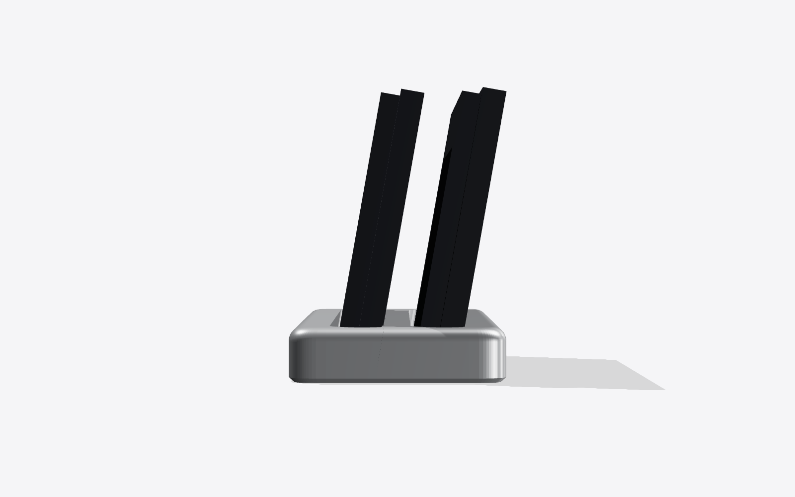

# Jiffy75 LP 縦置きスタンド


JezailFunder **Jiffy75**（左右分割・ロープロファイル 75%）を、左右2枚並べて立てて収納するスタンドです。
寸法はすべて **白銀比（1 : √2）** の数列から決め、Apple製品のような「一枚の塊から削り出した」見た目を狙いました。

| キーボードを入れた状態 | 側面（10°の後傾） |
|---|---|
|  |  |

| 上面 | スペースグレイ（色違いの例） |
|---|---|
|  |  |

## STL

- [`stl/jiffy75_stand.stl`](stl/jiffy75_stand.stl): 200 × 100 × 25 mm、約330 cm³、watertight確認済み

## 対象キーボードの寸法（調査値）

| 項目 | 値 |
|---|---|
| 左ハーフ | 156.4 × 127.7 mm |
| 右ハーフ | 176.1 × 127.7 mm |
| ケース厚 | 約 11 mm |
| キートップまでの高さ | 約 20〜23 mm |
| 重量 | 約 0.87 kg（左右合計） |

公式の厚み値は見つからなかったため、スロット幅は余裕を持たせて **25 mm** にしました。
キーボードは長辺（スペースバー側）を下にして差し込み、キー面を手前に向けます。

## 白銀比によるデザイン

すべての主要寸法は `S(k) = 200 / √2^k` の数列から取っています。

| k | 0 | 2 | 6 | 7 | 8 | 9 | 10 | 13 | 14 |
|---|---|---|---|---|---|---|---|---|---|
| mm | **200** | **100** | **25** | **17.7** | **12.5** | **8.84** | **6.25** | **2.21** | **1.56** |
| 用途 | 全幅 | 奥行 | 全高・スロット幅 | 角R・スロット深さ・脚位置 | 仕切り・脚径 | スロット端余白 | 上面エッジR | 底面の影ライン | スロット入口の面取り |

- 全幅 : 奥行 = 2 : 1 = (√2)²、奥行 : 高さ = 4 : 1 = (√2)⁴
- 後傾角も白銀比から: `atan(1 / 4√2) ≈ 10.0°`

## Appleらしさのための工夫

- **スクワークル（超楕円）コーナー**: 平面の角を円弧ではなく超楕円で丸め、曲率が連続する iPhone / Mac 風の角
- **上面の大きなR（6.25 mm）**: 手に触れる稜線をやわらかく
- **底面の45°面取り（2.21 mm）**: 机との間に細い影が落ち、本体が浮いて見える。サポート不要でプリント可能
- **スタジアム形スロット＋入口面取り**: 端が半円の溝で、差し込みがなめらか
- 底面に Ø12.5 × 深さ1 mm の凹み4か所: ゴム足やフェルトを貼る位置

## 印刷のおすすめ

- 向き: 底面をベッドに置く（そのままの向き）。**サポート不要**
- サイズ: 200 × 100 mm（一般的な 220 mm 以上のベッドで印刷可能）
- 素材: シルバー系のシルクPLA、または マットPLA（ホワイト / スペースグレイ）
- 設定例: 0.2 mm レイヤー、壁 3〜4周、インフィル 15〜20%（ジャイロイド）。重心を下げたいならインフィルを増やす
- 仕上げ: 上面をサンディング → サーフェサー → シルバー塗装にすると、アルマイト調に近づきます

## カスタマイズ

`src/stand.py` の先頭にある定数を変えて再生成できます。

```bash
pip install trimesh manifold3d scipy numpy
python3 src/stand.py
```

キートップが高く入らない場合は `SLOT_W` を大きく、ぐらつく場合は `SLOT_DEPTH` を `S(6)=25` に、`H` を `S(5)=35.4` にしてください（どちらも白銀比の数列内の値です）。

プレビュー画像の作り方は `preview/`（three.js + Playwright）を参照してください。

## 参考にした寸法情報

- [OZO Keyboards – Jiffy75 Wireless Split Low-Profile](https://www.ozokeyboards.com/products/jiffy75-wireless-split-low-profile-mechanical-keyboard)
- [KeyLab DB – Low-Profile Split Keyboards Compared](https://www.keylabdb.com/en/blog/low-profile-split-keyboards-compared)
- [green-keys – Jiffy75 (SP75) Advance Review](https://green-keys.info/en/jezailfunder-jiffy75-sp75-advance-review%EF%BD%9Ceasy-to-use-left-right-split-75-keyboard-with-low-switching-costs/)
- [Keyboard Builders' Digest – Jiffy75 review](https://kbd.news/Jiffy75-review-2818.html)
