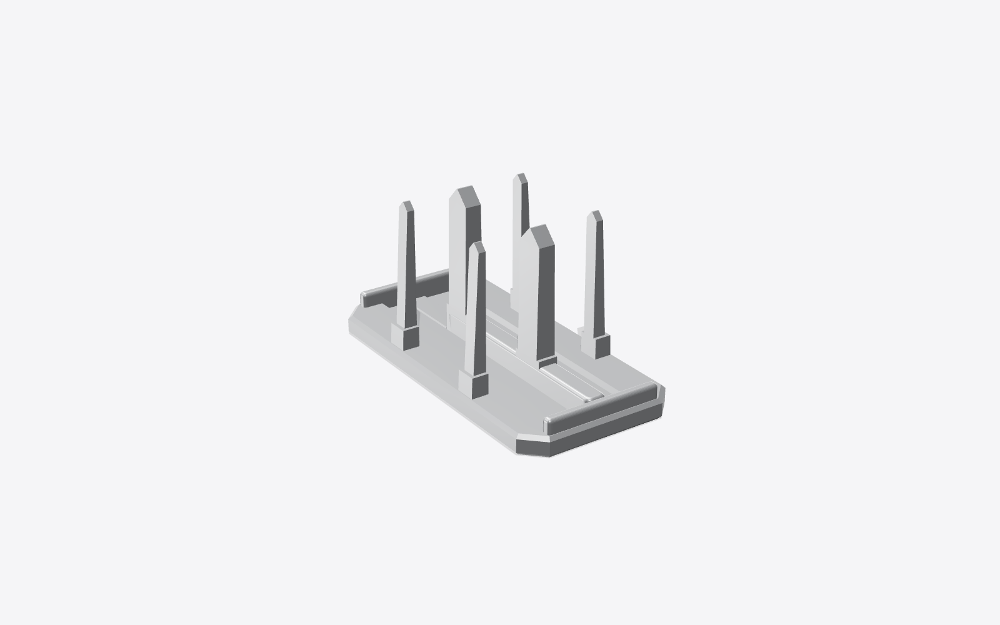
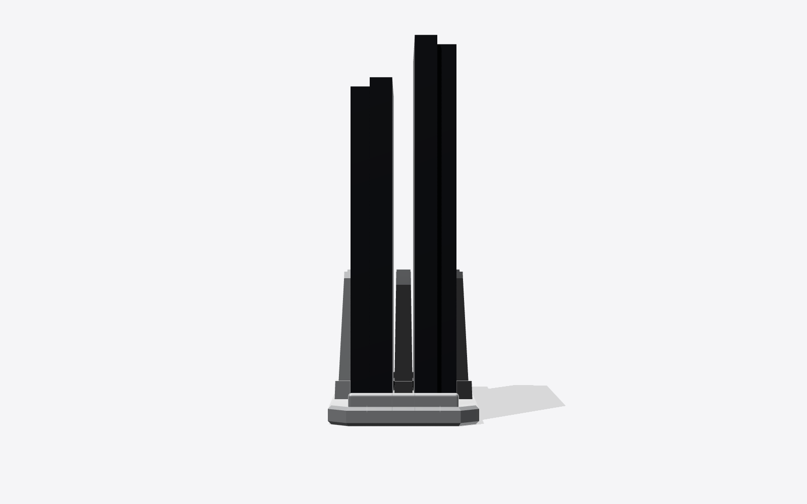

# Jiffy75 LP 縦置きスタンド "Silver Rack"



JezailFunder **Jiffy75**（左右分割・ロープロファイル 75%）の左右ハーフを、
**短辺（約128 mm側）を下にして背中合わせ**に立てて収納するラック型スタンドです。
角を落とした薄いプレートに、低いレールと細い柱6本を立てた構成で、寸法は **白銀比（1 : √2）** の数列から決めています。

| キーボードを入れた状態 | 正面 |
|---|---|
|  |  |

| 上面 | スペースグレイ（色違いの例） |
|---|---|
|  |  |

## 構成

| 部品 | 寸法 | 役割 |
|---|---|---|
| プレート | 70.7 × 141.4 × 厚さ 8.84 mm、角は 8.84 mm の45°カット | 土台 |
| 中央の溝 | 幅 34 / 深さ 3.125 / **長さ 129 mm**（左右のケースの縁＋足の逃げをひと続きに） | 約10 mm のケースの縁だけが入る。キーキャップは縁から約4 mm 浮いているので、プレート上面に当たらない |
| 背骨レール | 幅 9 / 高さ 6.25 mm（−Y 側の端の止めから、+Y 側の中央の柱まで） | 左右のケース裏面を仕切る。**+Y 側の端の約32 mm だけ**、ケース裏面の足（出っ張り5 mm）の逃げとして、溝の床から**高さ1 mm**の低いレールにしてある（`SPINE_OPEN_H`） |
| 端の止めレール | 厚さ 4.42 / 高さ 6.25 mm（両端、内側の間隔 129 mm） | キーボード（実測 128 mm）が前後にずれるのを止める。ガタは約1 mm |
| 中央の柱 ×2 | 9 → 7.17 mm にテーパー、奥行 12.5 mm、高さ 70.7 mm | ケース裏面を支える。上ほど細いので、左右のハーフがわずかに内側へもたれて安定する |
| 外側の柱 ×4 | 6.25 → 3.125 mm にテーパー、奥行 6.25 mm、高さ 70.7 mm | キーキャップ側を支える。**キーキャップとの隙間 1 mm**（内側の面は垂直） |

柱は高さ17.7 mmまで一回り太い台座（段差1.56 mm）になっていて、先端は45°の切妻形です。柱の位置は前後 ±25 mm（柱の間隔 50 mm）。

### ケース裏面の足への対応

ケース裏面には、立てたときに下になる短辺の両端近くに **5 mm 出っ張った足（5 × 20 mm）** があります。
ケース裏面を中央から 5.25 mm 離して置き（足 5 mm＋すき間 0.5 mm）、左右の足どうしがすれ違えるようにしました。
背骨レールは +Y 側の端の約32 mm を避けているので、**足を +Y 側（背骨レールが途切れている側）に向けて**差し込めば、足が端から0〜10 mm の位置にあっても当たりません（干渉チェック済み）。−Y 側は背骨レールを端の止めまで残しています（`SPINE_FULL_END`）。

## 断面

| 断面図（キーボードを入れた状態） | フィットテスト用ピース |
|---|---|
|  |  |

```
 柱 │ プレート（キー浮き）│ 溝 │ 背骨+柱 │ 溝 │ プレート │ 柱
    │_____________________│    │   ||    │    │__________│
                          │____│   ||    │____│
```

## STL

- [`stl/jiffy75_stand.stl`](stl/jiffy75_stand.stl): 本体。70.7 × 141.4 × 70.7 mm（柱の先端まで）、約98 cm³、watertight確認済み
- [`stl/jiffy75_stand_fit_test.stl`](stl/jiffy75_stand_fit_test.stl): **フィットテスト用（軽量版）**。足の逃げがある +Y 側の端（止めレール＋足の逃げ＋柱1列）を切り出したピース。70.7 × 55.5 × 12.3 mm、約14 cm³（切り出しただけの場合の約4割）。+Y 側の1 mm レールも含みます。先に印刷して、足が当たらないか・ケースが溝に入るか・キーキャップと柱の隙間を確認してください
  - 柱はプレート上面から 8 mm で切ってあります（キーキャップは上面から約0.9 mm 上から始まるので、隙間1 mm の確認には十分）
  - 底を削り、溝の床の下は 1.2 mm だけ残しています
  - キーキャップの下など、キーボードが触れない部分は窓状に抜いてあります
  - 確認用なので、インフィル 10〜15%・壁2周程度で十分です

## 対象キーボードの寸法

| 項目 | 値 |
|---|---|
| 左ハーフ | 156.4 × 127.7 mm（調査値） |
| 右ハーフ | 176.1 × 127.7 mm（調査値） |
| 短辺（立てたときの接地辺） | 128 mm（実測） |
| ケースの縁 | 約 10 mm（実測写真から） |
| ケース裏面の足 | 出っ張り 5 mm、5 × 20 mm、接地する短辺の両端近く（実測） |
| キーキャップの張り出し | 約 8〜9 mm、縁から約4 mm 浮く（実測写真から） |
| 重量 | 約 0.87 kg（左右合計、調査値） |

## 白銀比によるデザイン

主要寸法は `S(k) = 200 / √2^k` の数列から取っています。

| k | 1 | 3 | 6 | 7 | 8 | 9 | 10 | 11 | 12 | 14 |
|---|---|---|---|---|---|---|---|---|---|---|
| mm | **141.4** | **70.7** | **25** | **17.7** | **12.5** | **8.84** | **6.25** | **4.42** | **3.125** | **1.56** |
| 用途 | 全長 | 全幅・柱の高さ | 柱の前後位置（間隔50 = S(4)） | 台座高さ | 溝幅・中央柱の奥行 | プレート厚・角カット | レール高・外側柱の根元幅 | 端レール厚 | 溝深さ・外側柱の先端幅 | 台座段差・エッジ面取り |

- 全長 : 全幅 = 2 : 1 = (√2)²、柱の高さ = 全幅
- 柱の間隔 50 : 全幅 70.7 = 1 : √2
- 中央の柱と背骨の幅（9 mm）は足の出っ張りから実寸で決めています（`FOOT_H`）
- 外側の柱の位置だけは「キーキャップとの隙間 1 mm」から実寸で決めています（`CAP_GAP`）

## 印刷のおすすめ

- 向き: 底面をベッドに置く（そのままの向き）。**サポート不要**（柱の先端は45°）
- サイズ: 70.7 × 141.4 mm（ほぼすべての3Dプリンターで印刷可能）
- 設定例: 0.2 mm レイヤー、壁 3〜4周、インフィル 20〜30%。柱が細いので、PETG か PLA の場合は壁を多めに
- 柱が高く細いので、印刷速度は柱の部分で落とす（最小レイヤー時間を長めに）ときれいに仕上がります
- 底面の凹み4か所にゴム足を貼るとずれにくくなります

## カスタマイズ

`src/stand.py` の先頭にある定数を変えて再生成できます。

```bash
pip install trimesh manifold3d scipy numpy
python3 src/stand.py
```

| 症状 | 調整する値 |
|---|---|
| ケースが溝にきつい | `CASE_W` |
| キーキャップがプレートに当たる | `GROOVE_D` を深く（`KB_CAP_LIFT` 未満） |
| キーキャップと外側の柱の隙間を変えたい | `CAP_GAP` |
| 柱を高く／低く | `POST_TOP` |
| 足の出っ張り・大きさが違った | `FOOT_H` / `FOOT_L` |
| 足の逃げ側の低いレールの高さ | `SPINE_OPEN_H`（溝の床から、0で無し） |
| 前後のガタを変えたい | `CH_L`（初期値 = `KB_DEPTH` + 1 mm = 129 mm） |

プレビュー画像の作り方は `preview/`（three.js + Playwright）を参照してください。

## 参考にした寸法情報

- [OZO Keyboards – Jiffy75 Wireless Split Low-Profile](https://www.ozokeyboards.com/products/jiffy75-wireless-split-low-profile-mechanical-keyboard)
- [KeyLab DB – Low-Profile Split Keyboards Compared](https://www.keylabdb.com/en/blog/low-profile-split-keyboards-compared)
- [green-keys – Jiffy75 (SP75) Advance Review](https://green-keys.info/en/jezailfunder-jiffy75-sp75-advance-review%EF%BD%9Ceasy-to-use-left-right-split-75-keyboard-with-low-switching-costs/)
- [Keyboard Builders' Digest – Jiffy75 review](https://kbd.news/Jiffy75-review-2818.html)
